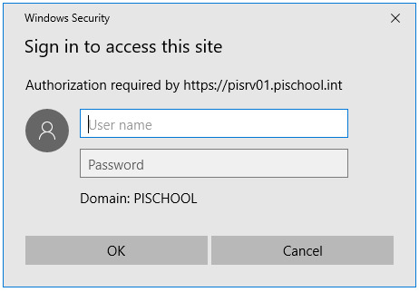

# Keycloak Kerberos Probe Plugin

This plugin for Keycloak detects if a client is capable of Kerberos authentication before attempting to authenticate them, avoiding unnecessary browser popups for non-domain-joined clients, anonymous browser mode etc.



## Features
- Checks if the client supports Kerberos using javascript.
- Skips Kerberos challenge for clients that cannot respond.
- Allows configuring probe timeout (default: 500ms).
- Can run the probe only for clients from listed IPv4/IPv6 networks (optional, default: all clients).
- Integrates directly into Keycloak authentication flows.

**Note:** This plugin does not configure Kerberos itself — you must already have a working Keycloak Kerberos setup. It only provides an automated detection layer.

## Changelog

v1.3.0 - optional `Internal networks` setting: the probe and the Kerberos condition run only for clients from the listed IPv4/IPv6 prefixes

v1.2.1 - fixed Edge leaving the Windows Security credential dialog open after redirect

v1.2.0 - compatible with Keycloak 26.6.x; probe endpoint changed to `/.well-known/kerberos-probe` (see [CHANGELOG.md](CHANGELOG.md) for details)

v1.1.0 - added configurable cookie lifespan

> **Upgrading from v1.1.0:** The probe URL changed from `/realms/{realm}/krb/test` to
> `/.well-known/kerberos-probe`. No configuration changes needed — the authenticator
> generates the new URL automatically.

## Installation

### Download the JAR (releases) and place it into providers directory:
```
/opt/keycloak/providers/keycloak-krb-probe.jar
```


### Mounting JAR in Docker (default image)
```
docker run \
  -v $(pwd)/keycloak-krb-probe.jar:/opt/keycloak/providers/keycloak-krb-probe.jar \
  quay.io/keycloak/keycloak:26.3.1 \
```


### Mounting JAR with Bitnami Keycloak Operator
Add your JAR as a ConfigMap

```
kubectl create configmap keycloak-krb-probe \
  --from-file=keycloak-krb-probe.jar  
```

Mount it (helm values)

```
extraVolumes:  
  - name: krb-probe  
    configMap:  
      name: keycloak-krb-probe  
extraVolumeMounts:
  - name: krb-probe
    mountPath: /opt/bitnami/keycloak/providers/keycloak-krb-probe.jar
    subPath: keycloak-krb-probe.jar
``` 

Restart the Keycloak pod after mounting.

**Note:** Your keycloak deployment in k8s may vary, adjust the mounting to your needs

## Usage in Authentication Flow

1. Go to **Authentication** → **Flows** in Keycloak admin console a edit your **browser** flow.
2. Insert the `Kerberos Backchannel Probe` execution **between** cookie and Kerberos authenticator 
3. Set it to **ALTERNATIVE**.
4. Adjust probe timeout in the plugin configuration if needed (default 500ms).
5. Add subflow: Add flow → Kerberos Path; set **ALTERNATIVE**; this subflow will replace `Kerberos` execution
6. Inside Kerberos Path:
  1. Add Condition – Kerberos Capable Cookie (REQUIRED).
  2. Add execution - Kerberos (REQUIRED).

7. Keep Username Password Form after the subflow (fallback).


```
Browser
  ├─ Cookie                          (ALTERNATIVE)
  ├─ Kerberos Backchannel Probe      (ALTERNATIVE)   ← plugin (top-level)
  ├─ Kerberos Path                   (ALTERNATIVE)   ← subflow
  │    ├─ Condition - KRB_CAPABLE    (REQUIRED)
  │    └─ Kerberos                   (REQUIRED)
  ├─ Identity Provider Redirector    (ALTERNATIVE)   (optional)
  └─ Username Password Form          (ALTERNATIVE)
```

Key points for setting this up:

* Kerberos Path is a subflow inside Browser, set to ALTERNATIVE.

* The probe runs first, sets a KRB_CAPABLE cookie if Kerberos works.

* Condition step checks the cookie before attempting Kerberos.

* Kerberos step executes SPNEGO authentication.

* If probe fails or Kerberos fails → flow continues to Username/Password Form.

## Limiting the probe to internal networks

Some browsers (Edge on Windows, for example) open a native credential dialog when they get a
`401 Negotiate` and have no Kerberos ticket. That happens on any machine without a ticket, including
laptops outside your network, and the plugin cannot close that dialog. The fix is to not send the
challenge to those clients at all.

Set **Internal networks** in the configuration of the `Kerberos Backchannel Probe` execution:

```
10.0.0.0/8, 192.168.0.0/16, fd00::/8
```

How it works:

* The value is a list of CIDR prefixes, IPv4 and IPv6, separated by commas, semicolons, spaces or new lines.
  A bare address (`192.0.2.5`) is treated as a single host.
* The field is optional. Empty means every client, which is the behavior of earlier versions.
* The probe checks the client IP first, before it looks at the `KRB_CAPABLE` cookie. A client outside the
  listed networks gets no probe and no cookie, and the flow goes on to the login form.
* The probe records the result in the authentication session. `Condition - KRB_CAPABLE` reads it, so the
  same list also covers the Kerberos step. A `KRB_CAPABLE=1` cookie from an earlier visit inside the
  network does not trigger Kerberos when the client is now outside. You configure the list once, on the probe.
* An invalid entry is logged as a warning and skipped. If the field is not empty but no entry is valid,
  no client matches, so Kerberos is off for everyone. Check the server log after changing the value.
* Host names are not resolved. IPv4-mapped IPv6 addresses (`::ffff:10.0.0.1`) match IPv4 prefixes.

Keep the probe in the flow when you use the list. `Condition - KRB_CAPABLE` needs it to know the network.
Without the probe in the same flow the condition falls back to checking the cookie only.

The plugin takes the address from `ClientConnection.getRemoteAddr()`. Behind a reverse proxy, Keycloak
returns the real client address only when proxy headers are enabled, for example
`KC_PROXY_HEADERS=xforwarded`, and the proxy must pass the client address in `X-Forwarded-For`.
Otherwise every client appears with the proxy's address.

Deeper explanation of how plugin works can be find in [detailed flow diagram](docs/flow.md).